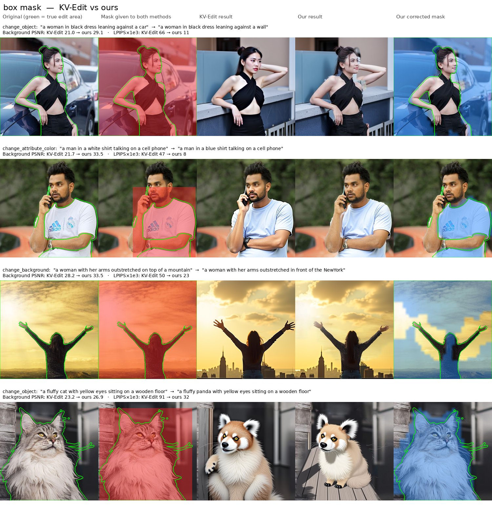
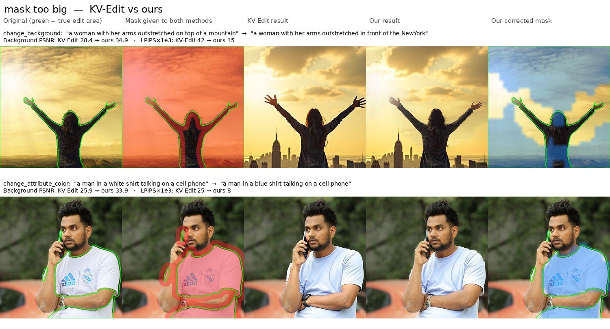

# Adaptive KV-Edit

Training-free editing on FLUX-dev with KV-Edit, where the user mask is refined by FLUX's own
image→edit-word attention and tightened over the denoising steps.

## Method (one paragraph)

Invert the source image once with KV-Edit (mask-independent, `attn_mask=False`). Run a few
full-image forward passes on the cached inverted latents with the target prompt and record, at every
double/single block, how much each image token attends to the edit-word tokens. Normalise the averaged
map `A`, and score each token as `s = w_user·M_user + (1−w_user)·A`, restricted to a dilated user mask.
Denoise with KV-Edit, regenerating tokens with `s > τ_loose` early and shrinking to `s > τ_tight` by
`sched_end`; tokens dropped from the mask are reset to the inverted source latent at that step
(per-step binarisation, which fits KV-Edit's fixed token set). With a constant user mask this is
bit-identical to KV-Edit (`tests/test_cpu_pipeline.py::test_matches_original_kvedit`).

## Layout

```
adaptive_kvedit/
  models/editing_backbone.py   FLUX/T5/CLIP/AE loading, offload, invert / edit(mask schedule) / probe
  models/feature_store.py      KV cache in RAM or spilled to disk
  models/text_encoder.py       [bracket] parsing, edit-token indices for FLUX's T5
  features/extraction.py       AttentionRecorder: per-(step, block) image→edit-token maps
  features/visualization.py    overlays, per-layer and per-step grids
  controller/                  fusion, attention-only, timestep schedule
  evaluation/metrics.py        PnPInversion protocol: bg PSNR/LPIPS/MSE/SSIM, CLIP whole/edited
  data/                        PIE-Bench loader, noisy-mask perturbations
scripts/  run_batch, compute_metrics, comparison, visualize_attention, make_figures,
          tune_controller, analyze_losses, compare_sheets, convert_fp8
demo/app.py                    Gradio demo
configs/default.yaml
```

## Setup

```bash
git clone --recursive <this repo> && cd adaptive-kvedit   # --recursive pulls third_party/KV-Edit
# (already cloned without it: git submodule update --init)
conda create -n akv python=3.10 -y && conda activate akv
pip install torch==2.6.0 torchvision==0.21.0 --index-url https://download.pytorch.org/whl/cu124  # match your CUDA driver
pip install -r requirements.txt
huggingface-cli login            # accept the FLUX.1-dev license first
# PIE-Bench (PnPInversion, via Google Form) -> data/PIE-Bench_v1/{mapping_file.json,annotation_images/}
pytest tests -q                  # CPU, ~10 s
python scripts/convert_fp8.py    # one-time, CPU only: FLUX-dev -> checkpoints/flux-dev-fp8 (~12 GB)
```

Memory (defaults target a 16 GB GPU): FP8 weight-only FLUX (~12 GB), prompt embeddings computed
first with T5/CLIP alone on the GPU and cached in `cache/text/`, KV cache spilled to `cache/features/`
(~17 GB per 512px image, deleted after each image). FP8 forward at 512px ≈ 1.0 s on an RTX 4060 Ti.
On a 40–80 GB GPU use `--set backbone.precision=bf16 backbone.feature_store=ram`.

The GPU needs ~15 GB free: stop other GPU jobs before a run.

## Runbook

```bash
# 1. Sanity check: KV-Edit's own example (data/mini_pie); compare with data/mini_pie/kvedit_reference_nana.png
python scripts/run_batch.py --out runs/mini --set pie_root=data/mini_pie --methods kvedit fused_sched
python scripts/visualize_attention.py --run runs/mini      # where FLUX attends for the edit word

# 2. Tuning on 20 dev images (disjoint from the test set), clean + noisy masks
python scripts/run_batch.py --out runs/dev --split dev --limit 20 --methods kvedit fused_sched \
    --noise none dilate erode box
python scripts/tune_controller.py --run runs/dev            # CPU; writes runs/dev/tuned.yaml
python scripts/run_batch.py --out runs/dev_tuned --split dev --limit 20 --methods fused_sched \
    --noise none dilate erode box --set @runs/dev/tuned.yaml
python scripts/compute_metrics.py --run runs/dev --device cuda
python scripts/compute_metrics.py --run runs/dev_tuned --device cuda
python scripts/analyze_losses.py --kvedit runs/dev/metrics.csv --ours runs/dev_tuned/metrics.csv
python scripts/compare_sheets.py --kvedit runs/dev --ours runs/dev_tuned --out runs/dev_tuned/sheets

# 3. Test set (100 images) and ablations, with the tuned settings
python scripts/run_batch.py --out runs/main --limit 100 --methods kvedit fused_sched --set @runs/dev/tuned.yaml
python scripts/run_batch.py --out runs/ablation --limit 30 --set @runs/dev/tuned.yaml \
    --methods kvedit attn fused fused_sched --noise none dilate erode box
python scripts/compute_metrics.py --run runs/main --device cuda
python scripts/compute_metrics.py --run runs/ablation --device cuda
python scripts/comparison.py runs/main/metrics.csv runs/ablation/metrics.csv --by-category
python scripts/make_figures.py --run runs/ablation --noise dilate --methods kvedit fused_sched
python demo/app.py
```

Older baselines (P2P, MasaCtrl, RF-Edit, …) are cited, not rerun: copy the KV-Edit paper's PIE-Bench
numbers into `configs/reported_baselines.csv` and `comparison.py` appends them.

## Results (work in progress)

PIE-Bench, background preservation outside the ground-truth mask (PSNR ↑ / LPIPS×1e3 ↓ / MSE×1e4 ↓).
Style edits have full-image masks, so no background, and are left out of these metrics.

Baseline reproduction:

| | PSNR | LPIPS | MSE |
|---|---|---|---|
| KV-Edit, paper (620 images) | 35.87 | 9.92 | 4.69 |
| KV-Edit, this repo (100 test images, FP8) | 35.66 | 8.04 | 4.63 |

### Test set: 100 images

Adaptive mask (`fused_sched`) vs KV-Edit on 100 stratified test images (10 per category, disjoint from
the dev images), settings fixed from dev tuning (`runs/dev_v2/tuned.yaml`: `w_user=0.6, tau 0.6→0.7`).
Each image is edited with the ground-truth mask and three rough versions of it (`runs/test`):

| Mask given | KV-Edit PSNR | Ours PSNR | KV-Edit LPIPS | Ours LPIPS | Ours wins (LPIPS) | CLIP edited KV / ours |
|---|---|---|---|---|---|---|
| clean | **35.66** | 35.09 | **8.04** | 8.25 | 31% | 22.50 / 22.53 |
| too small (erode 24 px) | **37.43** | 37.31 | **6.31** | 6.47 | 23% | 21.29 / 21.21 |
| too big (dilate 24 px) | 28.76 | **29.93** | 25.25 | **19.95** | 62% | 22.77 / 22.60 |
| bounding box | 27.22 | **29.17** | 48.59 | **28.40** | 65% | 22.96 / 22.65 |

- Rough masks: ours preserves much more background (box: +1.95 dB PSNR, −42% LPIPS; too big: +1.2 dB,
  −21% LPIPS), at a small cost in edit score (box CLIP −0.3).
- Too-small masks: tie. The tuned controller only trims masks, never grows them.
- Clean masks: ours is 0.57 dB lower on average. Most images are close, but about 10 lose 3–6 dB (mostly
  material changes and deletions); on those the final mask is 4–7% larger than the given one, because the
  hole-filling step (`close_tokens=1`) adds whole tokens just outside the user mask.

### Examples

Selected test images where ours does best and the edit worked for both methods; they are not typical
of every image (averages are in the table above). Columns: original with the true edit area in green,
the rough mask given to both methods (red), KV-Edit, ours, and our corrected mask (blue).

**Box mask.** KV-Edit redraws the whole box, so people, animals and scenery around the edit change; ours
trims the box and keeps them:



**Mask 24 px too big:**



To rebuild them, or browse all 100 test images: `python scripts/compare_sheets.py --kvedit runs/test
--ours runs/test --metrics runs/test/metrics.csv --noise box --keys 122000000004 622000000002
822000000002 121000000007 --out runs/test/examples` (leave out `--keys` for every image).

### Dev set: 20 images (used for tuning)

Same comparison on the 20 dev images (`runs/dev_v2`, `runs/dev_v2_tuned`). These images were used to
pick the settings, so the results are optimistic:

| Mask given | KV-Edit PSNR | Ours PSNR | KV-Edit LPIPS | Ours LPIPS | Ours wins (LPIPS) | CLIP edited KV / ours |
|---|---|---|---|---|---|---|
| clean | **36.15** | 35.82 | **9.69** | 10.07 | 20% | 19.84 / 19.99 |
| too small (erode 24 px) | **37.25** | 37.11 | **7.89** | 7.97 | 20% | 19.21 / 19.31 |
| too big (dilate 24 px) | 29.93 | **30.21** | 27.46 | **24.33** | 60% | 20.55 / 20.76 |
| bounding box | 30.00 | **30.81** | 39.37 | **28.94** | 70% | 20.48 / 20.54 |

History: an earlier version lost ~2 dB on clean dev masks. Two fixes closed most of that gap:
PIE-Bench masks contain a 1-px image frame, now removed from the methods' input (kept for scoring, as in
the PnPInversion protocol; it had turned every `box` mask into the full image), and the adaptive mask now
keeps the user mask's sub-token edges instead of whole 16×16 tokens.

## Limitations and future work

- The tuned controller only shrinks masks; too-small masks are not corrected.
- Hole filling can add tokens outside the user mask; restricting it to the user mask may close the
  clean-mask gap (to be checked on the dev set before rerunning the test set).
- Trimming the mask slightly lowers the edit score with rough masks (box CLIP −0.3).
- Attention is from one probe pass per step on the inverted latent, not from the edit trajectory.
- Masks are binary per step; soft latent blending is the alternative.
- Deferred: DINOv2 feature fusion, CLIP/dense-CLIP relevance, layer-adaptive control.
