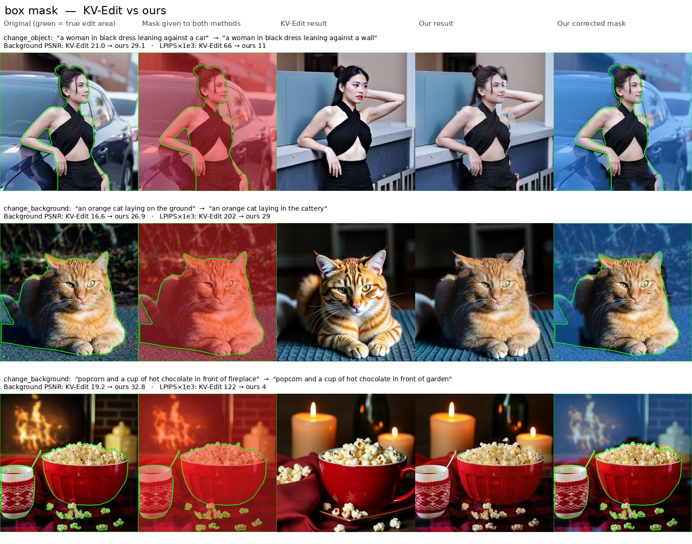
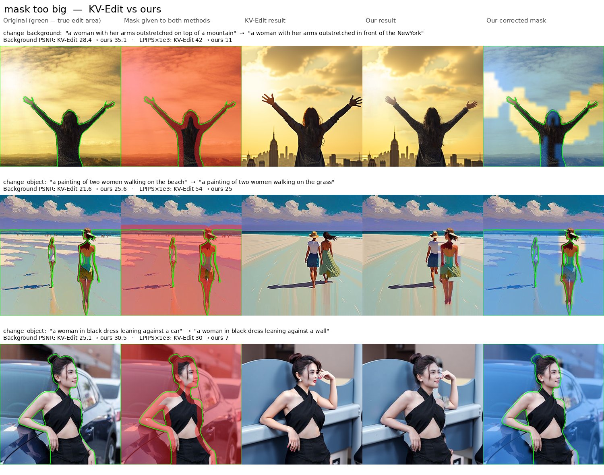
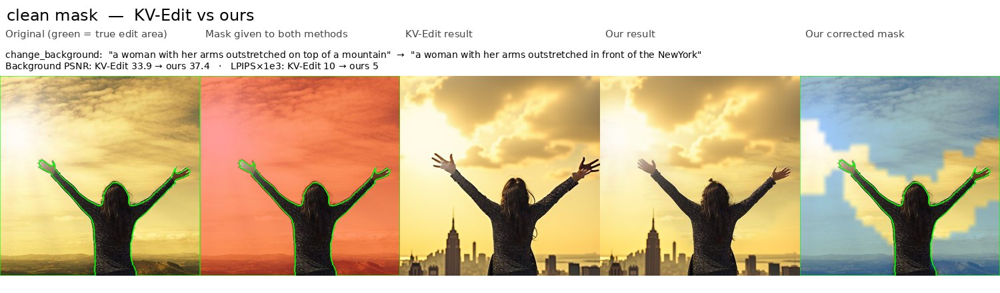
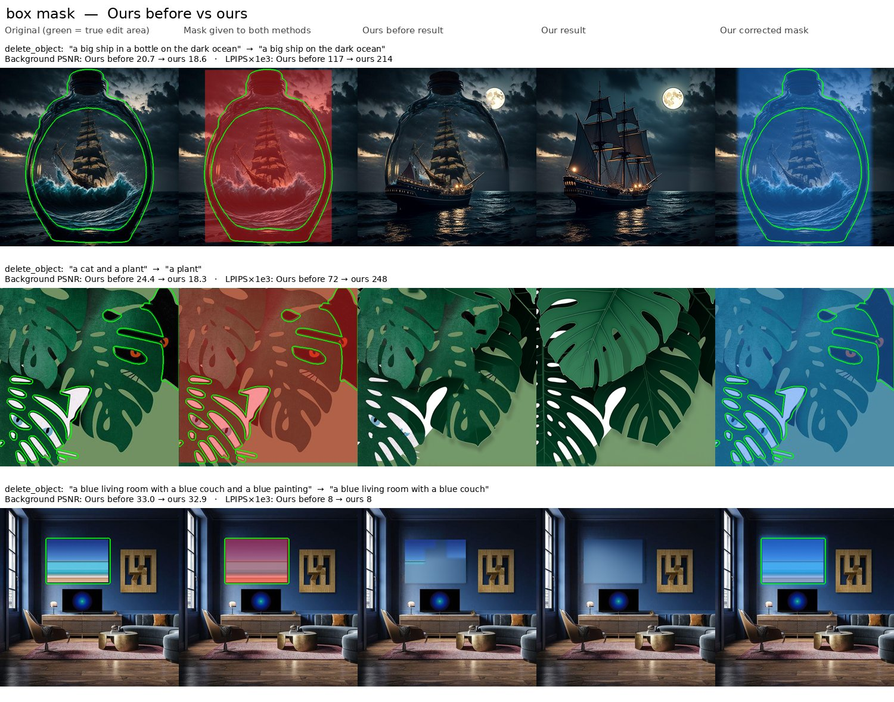
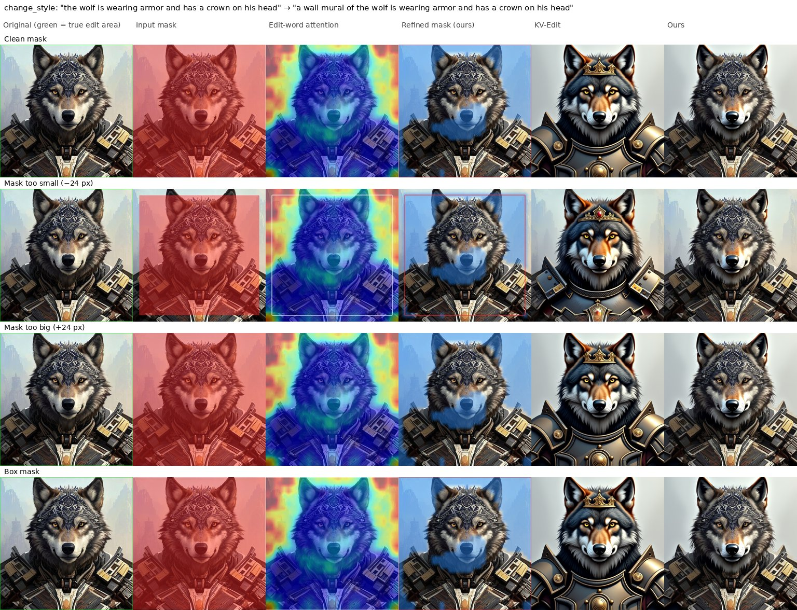
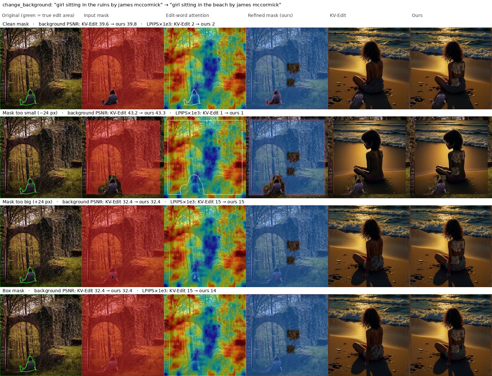

# Adaptive KV-Edit

Training-free editing on FLUX-dev with KV-Edit, where the user mask is refined by FLUX's own
image→edit-word attention and tightened over the denoising steps.

## Method (one paragraph)

Invert the source image once with KV-Edit (mask-independent, `attn_mask=False`). Run a few
full-image forward passes on the cached inverted latents with the target prompt and record, at every
double/single block, how much each image token attends to the edit-word tokens. Normalise the averaged
map `A`, and score each token as `s = w_user·M_user + (1−w_user)·A`, restricted to a dilated user mask.
Denoise with KV-Edit, regenerating tokens with `s > τ_loose` early and shrinking to `s > τ_tight` by
`sched_end`; tokens dropped from the mask are reset to the inverted source latent at that step
(per-step binarisation, which fits KV-Edit's fixed token set). With a constant user mask this is
bit-identical to KV-Edit (`tests/test_cpu_pipeline.py::test_matches_original_kvedit`).

Object removal is the exception: the whole object must be redrawn, so trimming would leave parts of it
behind. Removals (PIE-Bench `delete_object`, or the demo's "Object removal" checkbox) use the user mask
as-is, exactly like KV-Edit (`controller.keep_mask_on_removal`).

## Layout

```
adaptive_kvedit/
  models/editing_backbone.py   FLUX/T5/CLIP/AE loading, offload, invert / edit(mask schedule) / probe
  models/feature_store.py      KV cache in RAM or spilled to disk
  models/text_encoder.py       [bracket] parsing, edit-token indices for FLUX's T5
  features/extraction.py       AttentionRecorder: per-(step, block) image→edit-token maps
  features/visualization.py    overlays, per-layer and per-step grids
  controller/                  fusion, attention-only, timestep schedule
  evaluation/metrics.py        PnPInversion protocol: bg PSNR/LPIPS/MSE/SSIM, CLIP whole/edited
  data/                        PIE-Bench loader, noisy-mask perturbations
scripts/  run_batch, compute_metrics, comparison, visualize_attention, make_figures,
          tune_controller, analyze_losses, compare_sheets, convert_fp8
demo/app.py                    Gradio demo
configs/default.yaml
```

## Setup

```bash
git clone --recursive <this repo> && cd adaptive-kvedit   # --recursive pulls third_party/KV-Edit
# (already cloned without it: git submodule update --init)
conda create -n akv python=3.10 -y && conda activate akv
pip install torch==2.6.0 torchvision==0.21.0 --index-url https://download.pytorch.org/whl/cu124  # match your CUDA driver
pip install -r requirements.txt
huggingface-cli login            # accept the FLUX.1-dev license first
# PIE-Bench (PnPInversion, via Google Form) -> data/PIE-Bench_v1/{mapping_file.json,annotation_images/}
pytest tests -q                  # CPU, ~10 s
python scripts/convert_fp8.py    # one-time, CPU only: FLUX-dev -> checkpoints/flux-dev-fp8 (~12 GB)
```

Memory (defaults target a 16 GB GPU): FP8 weight-only FLUX (~12 GB), prompt embeddings computed
first with T5/CLIP alone on the GPU and cached in `cache/text/`, KV cache spilled to `cache/features/`
(~17 GB per 512px image, deleted after each image). FP8 forward at 512px ≈ 1.0 s on an RTX 4060 Ti.
On a 40–80 GB GPU use `--set backbone.precision=bf16 backbone.feature_store=ram`.

The GPU needs ~15 GB free: stop other GPU jobs before a run.

## Runbook

```bash
# 1. Sanity check: KV-Edit's own example (data/mini_pie); compare with data/mini_pie/kvedit_reference_nana.png
python scripts/run_batch.py --out runs/mini --set pie_root=data/mini_pie --methods kvedit fused_sched
python scripts/visualize_attention.py --run runs/mini      # where FLUX attends for the edit word

# 2. Tuning on 20 dev images (disjoint from the test set), clean + noisy masks
python scripts/run_batch.py --out runs/dev --split dev --limit 20 --methods kvedit fused_sched \
    --noise none dilate erode box
python scripts/tune_controller.py --run runs/dev            # CPU; writes runs/dev/tuned.yaml
python scripts/run_batch.py --out runs/dev_tuned --split dev --limit 20 --methods fused_sched \
    --noise none dilate erode box --set @runs/dev/tuned.yaml
python scripts/compute_metrics.py --run runs/dev --device cuda
python scripts/compute_metrics.py --run runs/dev_tuned --device cuda
python scripts/analyze_losses.py --kvedit runs/dev/metrics.csv --ours runs/dev_tuned/metrics.csv
python scripts/compare_sheets.py --kvedit runs/dev --ours runs/dev_tuned --out runs/dev_tuned/sheets

# 3. Test set (100 images) and ablations, with the tuned settings
python scripts/run_batch.py --out runs/main --limit 100 --methods kvedit fused_sched --set @runs/dev/tuned.yaml
python scripts/run_batch.py --out runs/ablation --limit 30 --set @runs/dev/tuned.yaml \
    --methods kvedit attn fused fused_sched --noise none dilate erode box
python scripts/compute_metrics.py --run runs/main --device cuda
python scripts/compute_metrics.py --run runs/ablation --device cuda
python scripts/comparison.py runs/main/metrics.csv runs/ablation/metrics.csv --by-category
python scripts/make_figures.py --run runs/ablation --noise dilate --methods kvedit fused_sched
python demo/app.py
```

Older baselines (P2P, MasaCtrl, RF-Edit, …) are cited, not rerun: copy the KV-Edit paper's PIE-Bench
numbers into `configs/reported_baselines.csv` and `comparison.py` appends them.

## Results (work in progress)

PIE-Bench, background preservation outside the ground-truth mask (PSNR ↑ / LPIPS×1e3 ↓ / MSE×1e4 ↓).
Style edits have full-image masks, so no background, and are left out of these metrics.

Baseline reproduction:

| | PSNR | LPIPS | MSE |
|---|---|---|---|
| KV-Edit, paper (620 images) | 35.87 | 9.92 | 4.69 |
| KV-Edit, this repo (100 test images, FP8) | 35.66 | 8.04 | 4.63 |

### Test set: 100 images

**Setup.** 100 stratified PIE-Bench images (10 per category, disjoint from the 20 dev images used for
tuning). Every image is edited with four masks: the ground-truth mask (*clean*), the mask eroded by
24 px (*too small*), dilated by 24 px (*too big*), and its bounding box (*box*). Settings are fixed from
dev tuning (`runs/dev_v2/tuned.yaml`: `w_user=0.6`, `τ 0.6→0.7`, `dilate_tokens=4`). Runs: KV-Edit
`runs/test`; ours `runs/test_final` (= `runs/test_v2`, plus the 10 removals from `runs/test_v3_removal`).
All tables are produced by `scripts/results_tables.py` (command below).

**Table 1: main result, KV-Edit → ours (final).** Bold = better.

| Mask given | PSNR ↑ | LPIPS×1e3 ↓ | MSE×1e4 ↓ | SSIM×1e2 ↑ | CLIP whole ↑ | CLIP edited ↑ | better / same / worse | p (PSNR) |
|---|---|---|---|---|---|---|---|---|
| clean | 35.66 → **36.00** | 8.04 → **7.56** | 4.63 → **4.36** | 96.47 → **96.61** | 25.68 → 25.58 | 22.50 → 22.32 | 42 / 30 / 6 | 5e-12 |
| too small | 37.43 → **37.45** | 6.31 → **6.29** | 3.91 → **3.90** | 96.83 → **96.84** | 24.71 → 24.61 | 21.29 → 21.20 | 20 / 53 / 5 | 2e-03 |
| too big | 28.76 → **30.05** | 25.25 → **19.40** | 18.92 → **13.95** | 94.39 → **95.20** | 25.83 → 25.73 | 22.77 → 22.60 | 59 / 15 / 4 | 1e-11 |
| box | 27.22 → **29.06** | 48.59 → **32.03** | 40.59 → **24.15** | 91.46 → **93.54** | 26.09 → 25.89 | 22.96 → 22.73 | 55 / 18 / 5 | 7e-11 |

Background metrics (PSNR, LPIPS, MSE, SSIM) are outside the ground-truth edit area, on the 78 non-style
images; CLIP scores are on all 100. *better / same / worse* counts images by LPIPS (removals are "same":
pixel-identical to KV-Edit). *p*: Wilcoxon signed-rank test on per-image PSNR.

- Background: ours is better on all four background metrics with every mask, and the gains are
  statistically significant (p < 0.01). They are large with rough masks (box +1.8 dB PSNR, −34% LPIPS;
  too big +1.3 dB, −23% LPIPS) and small with clean or too-small masks.
- Robustness: no image loses more than 0.2 dB PSNR against KV-Edit (Table 2).
- Cost: CLIP scores are 0.1–0.2 lower, i.e. the edit follows the prompt slightly less (mostly style
  edits; see Failure cases).

**Table 2: ablation, contribution of each refinement step.** Each row adds one step to the one above.

| Variant | clean PSNR / LPIPS | too small | too big | box | CLIP edited (all) | CLIP edited (style) | worst image ΔPSNR | edits ≤ −1 dB |
|---|---|---|---|---|---|---|---|---|
| KV-Edit (user mask as-is) | 35.66 / 8.04 | 37.43 / 6.31 | 28.76 / 25.25 | 27.22 / 48.59 | 22.38 | 27.47 | 0.00 | 0 |
| + attention fusion and loose→tight schedule (v1) | 35.09 / 8.25 | 37.31 / 6.47 | 29.93 / 19.95 | 29.17 / 28.40 | 22.25 | 26.86 | −5.91 | 29 |
| + hole filling kept inside the user mask | **36.02 / 7.53** | **37.45 / 6.29** | **30.15 / 18.93** | **29.19 / 28.22** | 22.16 | 26.86 | −0.20 | 0 |
| + no trimming for removals (final) | 36.00 / 7.56 | **37.45 / 6.29** | 30.05 / 19.40 | 29.06 / 32.03 | 22.21 | 26.86 | −0.20 | 0 |

*Worst image ΔPSNR* and *edits ≤ −1 dB* compare each edit with KV-Edit on the same image and mask
(312 background edits).

- **Attention fusion + schedule** gives the rough-mask gains (box +1.95 dB, LPIPS 48.6 → 28.4), but at
  first lost 0.57 dB on clean masks, with 29 edits losing more than 1 dB.
- **Hole filling inside the mask** removes all of those losses: clean masks go from −0.57 to +0.36 dB
  against KV-Edit, the worst edit loses only 0.2 dB, and the rough-mask gains stay or grow.
- **No trimming for removals** gives back a little background score (box LPIPS 28.2 → 32.0), because
  removals are again redrawn over the whole mask. In exchange the objects are actually removed (see the
  removal figure under Examples) and the edit score rises (CLIP edited 22.16 → 22.21).

**Table 2b: what each part of the final method does.** Same settings for every row (tuned values,
removals keep the user mask); one part is removed per row.

| Variant | clean PSNR / LPIPS | too small | too big | box | CLIP edited (all) | CLIP edited (style) | worst image ΔPSNR | edits ≤ −1 dB |
|---|---|---|---|---|---|---|---|---|
| KV-Edit (user mask as-is) | 35.66 / 8.04 | 37.43 / 6.31 | 28.76 / 25.25 | 27.22 / 48.59 | **22.38** | **27.47** | 0.00 | 0 |
| Attention only (user mask ignored) † | 31.57 / 26.46 | 31.57 / 26.46 | 31.57 / 26.46 | 31.57 / 26.46 | 21.68 | 25.08 | −19.05 | 134 |
| Fusion, no schedule (tight mask from step 1) | **36.06 / 7.52** | **37.46 / 6.29** | **30.52 / 18.35** | **29.61 / 29.68** | 21.98 | 26.31 | −3.18 | 4 |
| Fusion + schedule, no hole filling | 36.02 / 7.54 | **37.46 / 6.29** | 30.25 / 18.80 | 29.29 / 30.89 | 22.21 | 26.74 | −0.35 | 0 |
| Fusion + schedule + hole filling (ours) | 36.00 / 7.56 | 37.45 / 6.29 | 30.05 / 19.40 | 29.06 / 32.03 | 22.21 | 26.86 | −0.20 | 0 |

† ignores the user mask, so one result is used for every mask condition.

- **The user mask is needed.** Attention alone is a poor mask: on clean masks it is 4 dB worse than
  KV-Edit and 134 edits lose more than 1 dB (one loses 19 dB), because attention also lights up
  unrelated areas and misses parts of the object.
- **Fusion gives the background gains.** Adding attention to the user mask gives almost all of the
  rough-mask improvement (box 27.2 → 29.6 dB).
- **The schedule protects the edit.** Without it the background numbers are slightly higher, but the
  edit follows the prompt less (CLIP edited 21.98 vs 22.21) and some edits break (worst −3.2 dB,
  4 edits ≤ −1 dB). Starting loose and tightening later gives the object room to form first: worst
  edit −0.35 dB, none ≤ −1 dB. The final masks are the same in both rows; only the early steps differ.
- **Hole filling is a small fix.** It halves the masks with holes (142 → 83 of 360 adaptive edits, 50 →
  28 images), raises CLIP on style edits (26.74 → 26.86) and lowers the worst loss (−0.35 → −0.20 dB),
  for a small background cost (box LPIPS 30.9 → 32.0). The big v1 → hole-fix jump in Table 2 came from
  stopping the fill from leaking outside the user mask, not from the filling itself.

**Table 3: the hole-filling fix on the full test set.** Blocks regenerated outside the user's mask, in
the widest (earliest) mask of the schedule:

| Version | Edits | Edits with blocks outside the user mask | Images affected |
|---|---|---|---|
| v1 (`runs/test`) | 400 | 192 | 71 |
| hole filling inside mask (`runs/test_v2`) | 400 | **0** | **0** |
| final (`runs/test_final`) | 400 | **0** | **0** |

The fix was run on all 100 test images × 4 masks and works everywhere: no edit regenerates anything
outside the user's mask any more.

**Table 4: per category, box mask, KV-Edit → ours.**

| Category | PSNR | LPIPS×1e3 | CLIP edited |
|---|---|---|---|
| random | 28.48 → **29.59** | 23.65 → **19.53** | 21.96 → 21.46 |
| change object | 25.16 → **28.36** | 56.08 → **28.80** | 22.32 → 22.25 |
| add object | 30.42 → **31.79** | 22.74 → **14.03** | 24.78 → **24.87** |
| delete object | 25.73 → 25.73 | 70.59 → 70.59 | 18.66 → 18.66 |
| change content | 28.11 → **30.19** | 45.22 → **32.07** | 22.05 → 21.68 |
| change pose | 28.80 → **29.55** | 33.28 → **29.82** | 22.75 → 22.46 |
| change color | 28.70 → **30.95** | 34.71 → **22.73** | 19.21 → 18.95 |
| change material | 27.03 → **27.74** | 41.88 → **29.18** | 24.79 → 24.63 |
| change background | 22.06 → **28.70** | 124.62 → **34.37** | 25.08 → **25.13** |
| change style | — | — | 27.97 → 27.19 |

Ours improves the background in every category except removals (identical by design); the largest
gains are background changes and object changes. Style edits lose the most edit score.

To rebuild the tables (the second command gives Table 2b into `runs/test_ablation/results.md`):

```bash
python scripts/results_tables.py \
    --variant "KV-Edit=runs/test/metrics.csv:kvedit" \
    --variant "v1=runs/test/metrics.csv:fused_sched" \
    --variant "+ hole fill=runs/test_v2/metrics.csv:fused_sched" \
    --variant "final=runs/test_v3_removal/ours_merged.csv:fused_sched" \
    --masks "v1=runs/test" --masks "hole fix=runs/test_v2" --masks "final=runs/test_final" \
    --out runs/test_final/results.md
# ablation (GPU, ~9 h): attention only, fusion without schedule, no hole filling
python scripts/run_batch.py --out runs/test_ablation --methods attn fused fused_sched_nofill \
    --noise none dilate erode box --set @runs/dev_v2/tuned.yaml \
    'methods.fused_sched_nofill={mode: fused_sched, controller: {close_tokens: 0}}'
python scripts/compute_metrics.py --run runs/test_ablation --device cuda
python scripts/results_tables.py \
    --variant "KV-Edit=runs/test_final/metrics_vs_kvedit.csv:kvedit" \
    --variant "Attention only=runs/test_ablation/metrics.csv:attn" \
    --variant "Fusion, no schedule=runs/test_ablation/metrics.csv:fused" \
    --variant "Fusion + schedule, no hole fill=runs/test_ablation/metrics.csv:fused_sched_nofill" \
    --variant "Fusion + schedule + hole fill (ours)=runs/test_final/metrics_vs_kvedit.csv:fused_sched" \
    --out runs/test_ablation/results.md
```

### Examples

Selected test images where ours does best and the edit worked for both methods; they are not typical
of every image (averages are in the table above). Columns: original with the true edit area outlined in
green, the mask given to both methods (red), KV-Edit, ours, and our corrected mask (blue).

**Box mask.** KV-Edit redraws the whole box, so the woman, the cat and the bowl change; ours trims the box
and keeps them:



**Mask 24 px too big:**



**Clean mask.** Differences are usually small; here KV-Edit reshapes the arms and hair, ours keeps them:



**Object removal: ours before vs after the removal rule.** Trimming kept parts of the bottle, the cat
and the painting; now the whole mask is redrawn, as in KV-Edit. The background score drops, but the
object is actually removed:



To rebuild them, or browse all 100 test images: `runs/test_final` links each image's final result
(`runs/test_v2`, or `runs/test_v3_removal` for removals), and `metrics_vs_kvedit.csv` holds both
methods' rows. `python scripts/compare_sheets.py --kvedit runs/test --ours runs/test_final --metrics
runs/test_final/metrics_vs_kvedit.csv --noise box --keys 122000000004 821000000009 813000000000
--out runs/test_final/examples` (leave out `--keys` for every image; `--kvedit runs/test_v2
--kvedit-method fused_sched --kvedit-label "Ours before"` compares two of our runs).

### Failure cases

Ours is never clearly worse than KV-Edit at keeping the background: the 20 of 312 non-style edits where
its LPIPS is higher differ by at most 0.7 LPIPS×1e3 (0.04 dB PSNR), which is within run-to-run noise.
The failures are in the edit itself: trimming can remove regions that should change. Panels below:
`python scripts/make_panels.py ... --keys 911000000003 824000000003`. Columns as in the examples, plus
the edit-word attention and our refined mask (blue, input mask outlined in red).

**1. Style edits are mostly not applied** (the main failure). Style words such as "a wall mural of" or
"a photo of" do not point at one region: their attention is on the image borders and low on the main
subject. Trimming therefore drops most of the subject (30% of the mask removed on average), and that
part keeps its original look. On the 10 style images, ours changes the image about a third less than
KV-Edit (mean pixel change from the source, clean mask) and has a lower edit score on 30 of 40 edits.
This is hidden in the background table, because style edits have no background. Likely fix: treat
whole-image edits like removals and keep the user mask (e.g. when it covers most of the image).



*KV-Edit redraws the wolf (crown, new armour); ours keeps most of the original wolf, so the style barely
changes.*

**2. Holes in large masks leave patches of the original.** For a new background ("ruins" → "beach") the
attention is speckled, and a few isolated cold blocks inside the mask are kept from the source. They show
up as squares of the old texture inside the new scene (here on the girl's back). Hole filling only closes
1-block gaps; 37 of 360 adaptive edits (11 images) have such new holes. Likely fix: fill all holes that
lie inside the user mask, or drop kept islands smaller than a few blocks.



**3. Thin or peripheral parts can be trimmed.** Attention concentrates on the centre of the object, so
arms, sleeves and edges get lower scores. With rough masks they can drop out of the refined mask (e.g.
the outstretched arm in `622000000001`, "white dress" → "red dress"), which risks a partial edit. Here
both methods failed to change the colour at all, so it is not visible in the output.

**Not failures of our method:**

- *Per-image edit-score noise.* Several of the largest per-image CLIP drops (e.g. `122000000004` −3.6,
  `000000000130` −2.5) are on outputs that look the same as KV-Edit's. CLIP is noisy per image; only
  averages over many images are meaningful.
- *Edits that fail for both.* KV-Edit itself sometimes does not apply the edit (horse → zebra with the
  clean mask, white → red dress); ours inherits these failures.

### Dev set: 20 images (used for tuning)

Same comparison on the 20 dev images (KV-Edit: `runs/dev_v2`; ours: `runs/dev_v3_tuned`). These images
were used to pick the settings, so the results are optimistic:

| Mask given | KV-Edit PSNR | Ours PSNR | KV-Edit LPIPS | Ours LPIPS | CLIP edited KV / ours |
|---|---|---|---|---|---|
| clean | 36.15 | **36.17** | 9.69 | **9.45** | 19.84 / 19.80 |
| too small (erode 24 px) | 37.25 | 37.25 | 7.89 | **7.88** | 19.21 / 19.26 |
| too big (dilate 24 px) | 29.93 | **30.47** | 27.46 | **23.74** | 20.55 / 20.65 |
| bounding box | 30.00 | **30.81** | 39.37 | **28.40** | 20.48 / 20.49 |

History of the clean-mask PSNR gap to KV-Edit:

1. First version: about −2 dB on clean dev masks. Two fixes closed most of it. PIE-Bench masks contain
   a 1-px image frame, now removed from the methods' input (kept for scoring, as in the PnPInversion
   protocol; it had turned every `box` mask into the full image). The adaptive mask now also keeps the
   user mask's sub-token edges instead of whole 16×16 tokens.
2. Test set after those fixes (`runs/test`): −0.57 dB, with about 10 images losing 3–6 dB. Hole filling
   (`close_tokens=1`) added whole tokens just outside the user mask on 63 of 100 images.
3. Hole filling now stays inside the user mask (`runs/test_v2`): +0.36 dB, with no image losing more
   than 0.2 dB. Rough-mask gains are kept (box) or grow (too big: +1.2 → +1.4 dB).
4. Removals use the user mask as-is (`runs/test_v3_removal`). Trimming had left parts of removed
   objects; the 10 removal images now match KV-Edit exactly. Final: +0.34 dB on clean masks, +1.8 dB
   with box masks.

## Limitations and future work

- The tuned controller only shrinks masks; too-small masks are not corrected.
- Trimming the mask slightly lowers the edit score (CLIP edited −0.1 to −0.2), and style edits are
  mostly not applied (see Failure cases).
- Speckled attention can leave small holes in the refined mask, which keep patches of the original.
- Removals gain nothing over KV-Edit: they need to know the edit is a removal (PIE-Bench category or the
  demo checkbox) and then fall back to the user mask. Trimming with the removed words' attention is
  possible future work.
- The final mask is built from 16×16 tokens, so the boundary between kept and regenerated areas can
  show as a faint blocky seam on flat backgrounds.
- Attention is from one probe pass per step on the inverted latent, not from the edit trajectory.
- Masks are binary per step; soft latent blending is the alternative.
- Deferred: DINOv2 feature fusion, CLIP/dense-CLIP relevance, layer-adaptive control.
